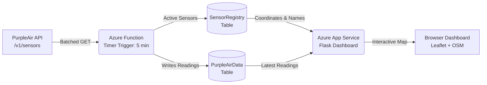

# Healthy Gulf - PurpleAir Air Quality Monitoring

A cloud-native air quality ingestion and visualization pipeline built on Microsoft Azure. It monitors PurpleAir air quality sensors across the Gulf Coast region, ingests PM2.5, temperature, and humidity on a 5-minute schedule, and presents the data on an interactive map dashboard.

---

## 🏗️ Architecture



1. **Ingestion Engine (`ingestion_function/`)**:
   - Azure Function running Python 3.11 with a Timer Trigger (`0 */5 * * * *`, every 5 minutes).
   - Reads all active sensors from `SensorRegistry`.
   - Fetches current readings for all sensors in **a single batched PurpleAir API call** (`GET /v1/sensors?show_only=...`) to minimize API point consumption.
   - Saves new records into the `PurpleAirData` Azure Storage Table.

2. **Database (Azure Table Storage)**:
   - **`SensorRegistry` Table**: Holds sensor metadata (`PartitionKey="HealthyGulf"`, `RowKey=sensor_id`, `Name`, `Location`, `IsActive`, `Latitude`, `Longitude`).
   - **`PurpleAirData` Table**: Holds historical readings (`PartitionKey=sensor_id`, `RowKey=timestamp_sensor_id`, `pm2_5`, `temperature`, `humidity`, `timestamp`).

3. **Web Dashboard (`display_webapp/`)**:
   - Python Flask application hosted on Azure App Service.
   - Interactive Leaflet/OpenStreetMap map displaying sensor pins colored by US EPA AQI breakpoints (Good, Moderate, USG, Unhealthy, Very Unhealthy, Hazardous).
   - Clicking a pin opens a modal popup showing live PM2.5, temperature, humidity, last reported time, and a link to the official PurpleAir map.
   - Summary statistics cards and recent readings table with local timestamp conversion.

---

## 📍 Managing and Updating Sensors

Sensors can be added, updated, or removed using either the **CSV workflow** (recommended, tracked in git) or directly via the **Azure Portal GUI**.

### Method 1: CSV Workflow (Recommended)

The file [`sensors.csv`](./sensors.csv) acts as the version-controlled source of truth for your sensor list.

#### 1. Add or Edit Sensors
Open `sensors.csv` and add your sensors:
```csv
sensor_id,name,location,is_active
27589,Iberville,,true
98161,Irish Channel,,true
```

#### 2. Sync to Azure Table Storage
Run the sync script:
```powershell
# Add / update sensors from sensors.csv
python sync_sensor_registry.py

# To also remove any sensors from Azure that are NOT in sensors.csv:
python sync_sensor_registry.py --prune

# To remove deleted sensors AND back up & delete their historical readings:
python sync_sensor_registry.py --prune --delete-readings
```

#### 3. Backfill Coordinates (For New Sensors)
If you added new sensors, look up their latitude/longitude so they appear on the map:
```powershell
python backfill_sensor_locations.py
```
*Note: This script queries PurpleAir once for only the new sensors' coordinates and saves them to `SensorRegistry`.*

---

### Method 2: Azure Portal GUI (No Code Required)

1. Open the [Azure Portal](https://portal.azure.com/).
2. Navigate to **Storage accounts** $\rightarrow$ `healthygulfstor8842` $\rightarrow$ **Storage browser** $\rightarrow$ **Tables** $\rightarrow$ **`SensorRegistry`**.
3. **To add a sensor**:
   - Click **+ Add entity**.
   - Set `PartitionKey` = `HealthyGulf`.
   - Set `RowKey` = `<sensor_id>` (e.g. `27589`).
   - Add properties: `Name` (String), `IsActive` (Boolean = `true`), `Latitude` (Double), `Longitude` (Double).
4. **To temporarily pause a sensor**:
   - Select the sensor row, click **Edit**, and change `IsActive` to `false`. The ingestion function will automatically skip it on the next run.
5. **To delete a sensor**:
   - Select the checkbox next to the sensor and click **Delete**.

---

## 🧪 Local Development & Testing

All local operations connect securely to your Azure Storage using credentials stored in your local `.env` file (which is git-ignored).

### 1. Prerequisites & Installation
Ensure Python 3.11+ is installed, then install dependencies:
```powershell
pip install -r display_webapp/requirements.txt
pip install -r ingestion_function/requirements.txt
```

### 2. Test Ingestion Locally
To execute the exact same batched ingestion logic as the cloud Azure Function:
```powershell
python test_local_ingest.py
```
This fetches readings for all active sensors in `SensorRegistry` in 1 API call and writes them to Azure Table Storage.

### 3. Run the Dashboard Locally
To load historical data in the Events tab, add a PurpleAir **READ** API key to the project-root `.env` file as `PURPLEAIR_API_KEY`. The tab checks registered sensors for the previous 7 days of 10-minute PM2.5 history and caches results in the running app for 15 minutes.

```powershell
cd display_webapp
python app.py
```
Open [http://localhost:8000](http://localhost:8000) in your web browser.

---

## 🚀 Deployment & CI/CD

Both services are deployed automatically via **GitHub Actions** workflows whenever you push changes to `main`:

- **Web App**: Triggered on changes to `display_webapp/**` via [`.github/workflows/main_healthygulf-dashboard-app.yml`](./.github/workflows/main_healthygulf-dashboard-app.yml).
- **Function App**: Triggered on changes to `ingestion_function/**` via [`.github/workflows/main_healthygulf-ingest-func.yml`](./.github/workflows/main_healthygulf-ingest-func.yml).

To deploy any changes:
```powershell
git add .
git commit -m "Update sensors and dashboard"
git push origin main
```

Live Dashboard URL: **`https://healthygulf-dashboard-app.azurewebsites.net`**

---

## ⏸️ Preserving API Points / Pausing Ingestion

When you want to pause data collection so you do not burn PurpleAir API tokens:

1. In the [Azure Portal](https://portal.azure.com/), open **Function App** $\rightarrow$ `healthygulf-ingest-func`.
2. On the **Overview** page, click **⏹️ Stop**.
3. To resume ingestion at any time, simply click **▶️ Start**.

*(Note: The web dashboard runs independently and will remain online and accessible even while the ingestion function is stopped.)*
